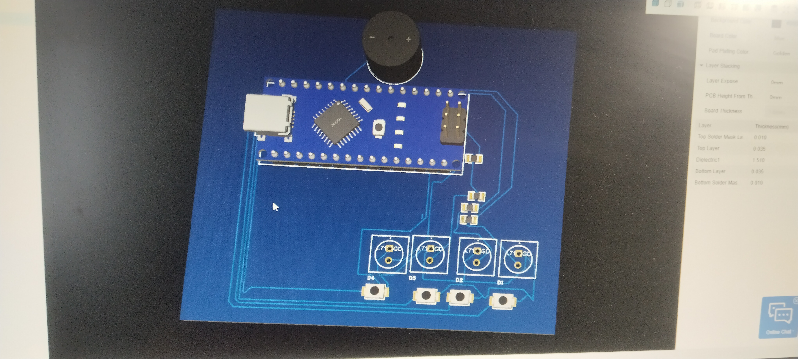

# Simon Says PCB Project / Projektna ploča "Simon Says"

[Srbija / Srpski](#srpski) | [English](#english)

---

## 🇷🇸 Srpski

### Opis projekta
Ovaj projekat predstavlja hardversku i softversku realizaciju poznate elektronske igre pamćenja **"Simon Says"** (Simon kaže). Projektovan je u EasyEDA Pro okruženju, prilagođen za izradu štampane pločice (PCB) sa komponentama u kroz-rupice (THD / Through-Hole Technology) radi lakšeg ručnog lemljenja.

### Prikaz projekta / Render

### Sadržaj repozitorijuma
- **`ProPrj_simon_says_react...epro2`**: Izvorni projekat u EasyEDA Pro formatu.
- **`IMG_20261011_131501.jpg`**: Slika / render pločice.

### Komponente
- **LED diode**: THT L7113ID (Crvena) / L7113GD (Zelena) / odgovarajuće LED indikatorske diode.
- **Otpornici**: THT AXIAL-0.3 otpornici.
- **Tasteri**: THT taktički tasteri (push buttons) za unos koraka u igri.
- **Zvučnik / Zujalica**: Piezo buzzer za zvučne efekte.

---

## 🇬🇧 English

### Project Overview
This repository contains the hardware design and source files for the **"Simon Says"** electronic memory game PCB. Designed using EasyEDA Pro, the board utilizes Through-Hole Technology (THT) components for straightforward manual assembly and soldering.

### Project Preview

### Repository Contents
- **`ProPrj_simon_says_react...epro2`**: Official EasyEDA Pro project source file.
- **`IMG_20261011_131501.jpg`**: Board picture / render.

### Components Used
- **LEDs**: THT L7113ID / L7113GD series.
- **Resistors**: Standard THT AXIAL-0.3 footprint resistors.
- **Push Buttons**: THT tactile switches for game input.
- **Buzzer**: Piezo buzzer for audio feedback.